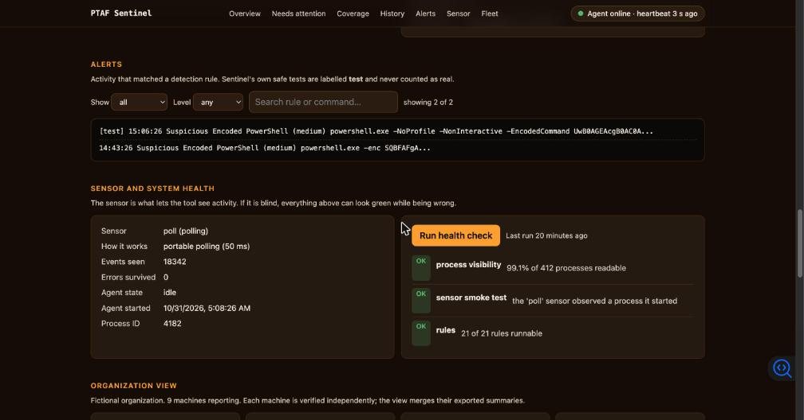

# PTAF Sentinel

### Unit tests for your detection rules, running on every machine.

[](https://github.com/Mangesh-Bhattacharya/Purple-Team-Automation-Framework/actions/workflows/ci.yml)
[](LICENSE)


Detection rules fail **silently**. A rule gets edited, a log pipeline breaks, an EDR update changes what is
reported, and nothing errors: the dashboard just stays quiet, and quiet looks like safe.

PTAF Sentinel runs **harmless imitations of attacker behavior** on a machine, watches that machine's own
telemetry, runs your [Sigma](https://github.com/SigmaHQ/sigma) rules against it, and tells you in plain
English which behaviors were caught, which were **missed**, and when something that *used to* work
**stopped** working.



## Try it

```bash
git clone https://github.com/Mangesh-Bhattacharya/Purple-Team-Automation-Framework.git
cd Purple-Team-Automation-Framework
python3 -m venv .venv && . .venv/bin/activate      # Windows: .venv\Scripts\activate
pip install .
ptaf up
```

Prefer one line? `pipx install git+https://github.com/Mangesh-Bhattacharya/Purple-Team-Automation-Framework.git`
(then `ptaf up`).

`ptaf up` starts the agent **and** a live dashboard and opens your browser. The first safe tests run
immediately; results appear in about ten seconds and the page then updates live. `Ctrl-C` stops everything
cleanly. On **Kali Linux** use `./packaging/install-kali.sh` (it handles the PEP 668 restriction) and run
with `sudo` for the event-driven sensor: see [docs/kali.md](docs/kali.md).

> Use PTAF only on systems you own or are authorized to test. Its tests can trigger security alerts.
> Run `ptaf legal` or read [TERMS.md](TERMS.md).

## What makes it different

- **It verifies instead of assuming.** A rule that exists is not a rule that fires. Every result is "a
  specific harmless test was caught by a specific rule on this machine, just now".
- **It tells a rule gap from a blind sensor.** `missed` (your rule is wrong) and `no telemetry` (your
  sensor can't see) are different statuses with different exit codes, so a broken sensor can never pass a
  CI gate. `ptaf doctor` measures how much the sensor can actually see.
- **Bring your own rules.** `ptaf rules check <dir>` says which of *your* Sigma rules it can run, and why
  not for the rest. On the public SigmaHQ set, **94% of process-creation rules are runnable**
  ([method and caveats](docs/sigmahq-coverage.md)).
- **It works the day you install it.** One command, live updates pushed to the page within ~0.1 s, a
  first-run screen that explains what is happening, and clean shutdown on `Ctrl-C` and `SIGTERM`.
- **Honest analysis agents.** Triage, Explain, Fix, Planner and Readiness turn the numbers into a
  prioritized to-do list. They are **rule-based and local** (no AI model, nothing leaves the machine) and
  the page says so.
- **Safe by construction.** Canaries sleep, decode a constant, run read-only queries, or print a tool's
  version. No network, no file writes, no credentials. A test enforces it.
- **Drift alerts.** A behavior that was caught yesterday and is not today raises an alert, with the
  regression shown on a per-check timeline.
- **Kill-chain view and a browser Detection Lab.** See where an attack would be seen along the ATT&CK
  tactics, play it as a story, and test a rule against an event in your browser.

## What has actually been verified

| Claim | Evidence |
|---|---|
| Works on Windows, macOS, Linux, Python 3.10 and 3.12 | CI runs the **real canaries** on all six combinations |
| Works on real Kali | CI runs the installer and a self-test inside the official `kalilinux/kali-rolling` image |
| Event-driven sensor catches real offensive tools | On a real Linux kernel: `nmap`, `hydra`, `sqlmap`, `tcpdump` canaries detected, 9 of 9 |
| Live updates are fast | 10 of 10 pushed updates arrived within 0.15 s (median 0.08 s) |
| Memory stays flat in a long run | +1.3 MB over 800 short-lived processes in a 90 s soak |
| The in-browser Lab matches the agent | Identical results on 494 rule/event pairs and every shipped rule file |
| A fresh install just works | New virtualenv install: dashboard in 1.9 s, real results in ~11 s, clean stop |

## Honest limits

- **Process-creation telemetry only.** No network, file, registry or authentication rules yet; `ptaf rules
  check` reports those as unsupported instead of ignoring them.
- **The default sensor polls every 50 ms**, so it can miss very short-lived processes. Linux can use the
  kernel's event feed (root) which catches processes that live tens of milliseconds; below about a
  millisecond needs auditd or eBPF, which PTAF does not use yet.
- **Verified on CI runners and one developer machine**, not on hardened, EDR-protected or domain-joined
  fleets, and not on physical ARM or NetHunter Kali.
- **Release applications are unsigned** (macOS Gatekeeper and Windows SmartScreen will warn). On macOS
  build the folder form (`python packaging/build.py --onedir`): a single file takes ~14 s to start there.
- **"Runnable" is not "good".** It means PTAF can evaluate a rule on its telemetry, not that the rule is
  accurate or free of false positives.
- English only. No central console yet: the organization view merges exported summaries.

## Commands

| | |
|---|---|
| `ptaf up` | agent + live dashboard in one command |
| `ptaf selftest` | run the safe tests once; exit codes 0 ok, 1 gap or drift, 3 sensor problem (`--format junit` for CI) |
| `ptaf monitor` | run as a long-lived agent |
| `ptaf doctor` | preflight: how much can this machine's sensor see? |
| `ptaf canaries` | list exactly what will run (nothing is executed) |
| `ptaf rules check <dir>` | which of your Sigma rules can run, and why not |
| `ptaf dashboard [--export f.html] [--fleet dir]` | dashboard, shareable snapshot, or organization view |
| `ptaf legal` | license, acceptable use and privacy notice |

## Documentation

[docs/sentinel.md](docs/sentinel.md) · [docs/enterprise.md](docs/enterprise.md) ·
[docs/kali.md](docs/kali.md) · [docs/sigmahq-coverage.md](docs/sigmahq-coverage.md) ·
[CONTRIBUTING.md](CONTRIBUTING.md) · [CHANGELOG.md](CHANGELOG.md)

## Pricing

The software is free (MIT). Optional paid help (health check, assessment, support, workshop) is listed in [docs/PRICING.md](docs/PRICING.md), in USD.

## Roadmap (not built yet)

Native Windows and macOS event sensors (Sysmon/ETW, Endpoint Security) · network and registry telemetry ·
more canaries (today: 19) · a GitHub Action · PyPI and container packaging · signed releases · optional
alert forwarding to Slack/Teams/webhooks · a central console. Ideas from the project's early scaffolding
(phishing emulation, cloud IAM checks, PDF reports) are **not implemented**.

## Legal

Licensed under the [MIT License](LICENSE). See [TERMS.md](TERMS.md) (acceptable use, no warranty),
[PRIVACY.md](PRIVACY.md) (no telemetry), [COPYRIGHT.md](COPYRIGHT.md),
[TRADEMARK.md](TRADEMARK.md), [THIRD_PARTY_NOTICES.md](THIRD_PARTY_NOTICES.md) and
[SECURITY.md](SECURITY.md). These are plain-language documents, not legal advice.

## Author

[Mangesh Bhattacharya](https://github.com/Mangesh-Bhattacharya): cybersecurity practitioner and MITS-AI
graduate (Ontario Tech University).
