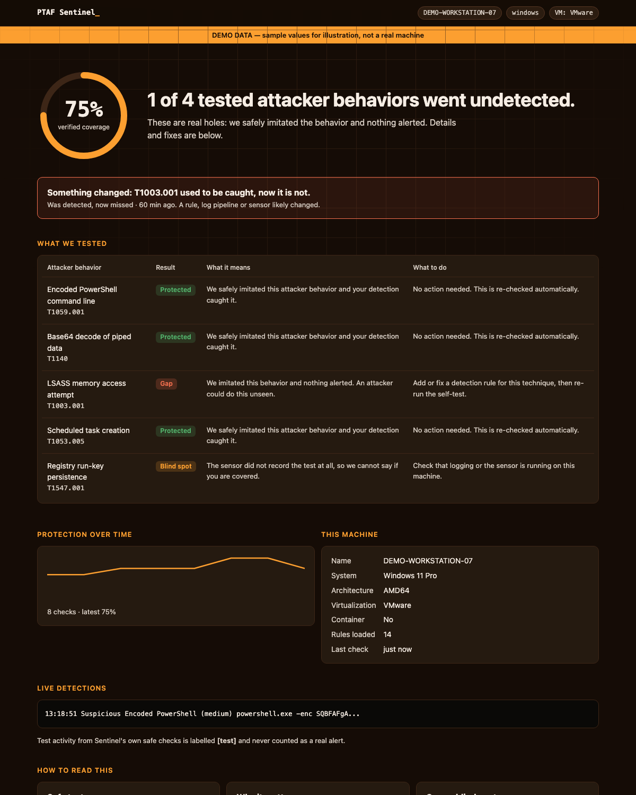

# Your detections are probably broken. You just can't hear it.

*Draft for Medium / LinkedIn Article / personal site. Replace nothing in angle brackets until verified.*

A smoke alarm that has lost its battery looks exactly like one that works.
It sits on the ceiling, calm and green, until the day you need it.

Detection rules are the same. A rule gets tweaked during a noisy week. A log
forwarder quietly stops. An EDR update changes how a process is reported. Nothing
errors. Nothing alerts. The dashboard stays quiet, and quiet looks like safe.

I built **PTAF Sentinel** to answer one question on every machine, continuously:
*if an attacker did this right now, would we actually notice?*

## How it works

1. **Safe canaries.** Sentinel launches harmless, local, no-op processes shaped
   like real attacker behavior, such as an encoded PowerShell command line or a
   base64 decode. No network, no file writes, no credentials, no persistence.
2. **Real telemetry.** It watches the host's own process events, with no
   kernel driver and no admin rights.
3. **Your rules, executed.** It runs your Sigma rules against what it saw and
   records whether one fired.
4. **Drift alerts.** If something was detected yesterday and is not today, you
   get a `detection_drift` alert. That is the silent failure nothing else shows.

```bash
pip install -e .
ptaf selftest
```

## Something I found by running it

PTAF's own example PowerShell rule shipped with a doubled backslash
(`'\\powershell.exe'` in single-quoted YAML). It could never match a real Windows
path. It passed syntax validation for weeks. The first time the rules were
actually *executed*, that bug was the first thing to surface. That is the whole
argument for this tool in one anecdote.

## For people who aren't engineers

The dashboard (`ptaf dashboard`) leads with a sentence, not a graph: "1 of 4
tested attacker behaviors went undetected," then what changed, what it means and
what to do. You can export it as one HTML file to hand to a client.



## What it does not do (yet)

Honesty is part of the product:

- The default collector polls processes every 50 ms, so it can miss anything
  shorter. Native Sysmon, auditd and macOS Endpoint Security collectors are next.
- Ten canaries ship today. Coverage percentages only count techniques that have a
  canary, and the dashboard says so.
- Only process-creation rules are evaluated so far.
- Verified live on macOS only so far (6 of 6 canaries detected). Windows and Linux are
  covered by modelled-telemetry tests; <fill in after the CI matrix runs>.

## Try it, break it, extend it

New canaries are small and the safety bar is written down in CONTRIBUTING.md.
If you can describe a harmless way to exercise a technique, I want the PR.

Repo: https://github.com/Mangesh-Bhattacharya/Purple-Team-Automation-Framework
